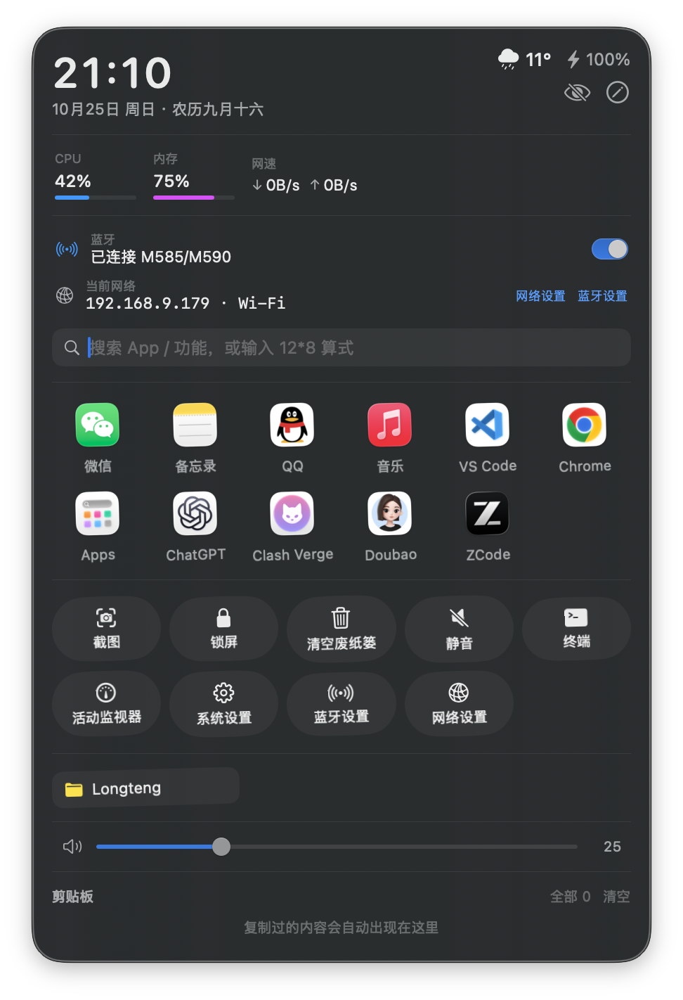

# 快捷台 QuickDeck



[](https://github.com/skydeadpeng/QuickDeck/actions/workflows/build.yml)

一个原生 macOS 桌面悬浮快捷面板：常驻桌面、半透明玻璃质感、不抢焦点、无 Dock 图标。
把常用的 App、系统功能、网址和文件夹都收进一张贴在桌面角落的小卡片里。

## 功能

- **信息条**：时钟 + 日期 + 农历 + 天气（Open-Meteo 免费接口，无需注册）+ 电池电量
- **系统监控**：CPU 占用 + 内存占用（带迷你进度条）+ 实时网速（↓上行 ↓下行），2 秒刷新，Mach 底层接口无需任何权限
- **无线网络控制**：Wi-Fi 开关（显示当前连接的 Wi-Fi 名）、蓝牙开关（显示已连接的设备名，如鼠标键盘）、本机 IP 地址、一键直达网络设置 / 蓝牙设置。蓝牙通过系统 IOBluetooth 接口原生控制，首次点击开关时系统会弹一次蓝牙授权，点「允许」即可
- **天气详情**：点击面板上的天气温度，查看未来 24 小时逐时预报
- **省电设计**：面板隐藏（⌥+空格）时自动暂停全部后台轮询（CPU/网速/剪贴板/蓝牙等），呼出时立即恢复并刷新
- **面板宽度可调**：设置里选 紧凑 320 / 标准 380 / 宽敞 440，App 网格列数自动适应（380 起一行 5 个）
- **搜索 & 计算器**：面板顶部搜索框——搜已加的面板项、搜**全盘已安装的 App**（可直接打开或一键加入面板）、输入 `12*8` 算式回车直接复制结果（支持 + - * / % ^ 括号）
- **剪贴板历史**：复制过的内容自动收进面板（最近 4 条），点「全部」查看最多 50 条，点击任意一条即复制回去；仅内存保存、退出自动清空，隐私安全
- **音量控制**：面板内音量滑块 + 静音按钮，键盘改音量也会自动同步
- **全局快捷键**：默认 **⌥ + 空格** 一键显示 / 隐藏面板，不用时完全收起（设置里可换成 ⌃⌥空格、⌥D、⌥/、F6）
- **App 快速启动**：从已安装的 App 里自选，点击图标直接打开；已卸载的 App 图标会变暗
- **系统快捷功能**：截图、锁屏、清空废纸篓、深色/浅色切换、静音、终端、活动监视器、睡眠、重启 Dock、显示/隐藏桌面图标、访达显示隐藏文件、系统设置、清空剪贴板
- **网址 / 文件夹快捷方式**：一键用默认浏览器打开网址、在访达中打开文件夹
- **便签**：随手记录自动保存（默认隐藏，设置 → 显示内容里开启）
- **自定义**：✏️ 编辑模式下可删除、可添加、可**拖动图标排序**；面板按住空白处拖动，位置自动记住
- **开机自启**：设置里一键开启（需要先把 App 放进「应用程序」文件夹）

## 构建与安装

需要 Xcode 命令行工具（Swift 5.9+），在项目目录执行：

```bash
./build.sh
```

产物在 `build/QuickDeck.app`。双击运行，或拖到「应用程序」文件夹后从启动台打开。

## 首次使用的权限弹窗（按需出现）

| 弹窗 | 什么时候出现 | 说明 |
|---|---|---|
| 屏幕录制 | 第一次点「截图」 | macOS 要求，允许后即可正常截图 |
| 自动化（System Events） | 第一次点「深浅切换」 | 用于切换深色/浅色外观，点「好」即可 |
| 蓝牙 | 第一次点「蓝牙」开关 | 用于开关蓝牙和读取设备名，点「允许」即可 |

其余功能（锁屏、清废纸篓、静音、Wi-Fi 开关、网络设置等）不需要任何授权。

## 常见问题

- **面板不见了？** 先按 **⌥ + 空格**（默认快捷键）呼回。位置被记住在 `defaults delete com.local.quickdeck` 可以重置（先退出 App）。多显示器拔插后如果面板跑出屏幕，重新启动 App 会自动回到可见区域。
- **快捷键没反应？** 可能与其他软件（输入法、其他效率工具）冲突，去 设置 → 快捷键 换一个组合。
- **如何彻底退出？** 面板上右键 → 退出 快捷台。
- **数据存在哪？** `~/Library/Application Support/QuickDeck/shortcuts.json`，可以直接备份。
- **天气城市怎么改？** 右键 → 设置 → 天气城市，输入城市名搜索（支持中文和拼音拼写如 Chengdu）。

## 开发说明

- 纯 SwiftUI + AppKit，Swift Package 管理，无第三方依赖
- `swift build` 直接编译调试，`./build.sh` 出正式 .app 包
- 主要源码在 `Sources/QuickDeck/`，每个文件职责单一（窗口 / 界面 / 数据 / 各服务）
- 推送 tag（如 `v1.5.0`）会触发 GitHub Actions 自动构建并发布 Release，可在仓库 Releases 页直接下载编译好的 App

## 开源协议

[MIT](LICENSE)，随便用、随便改，记得保留协议声明就行。
